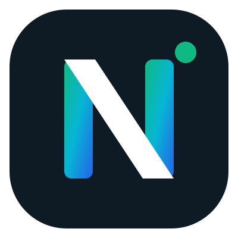
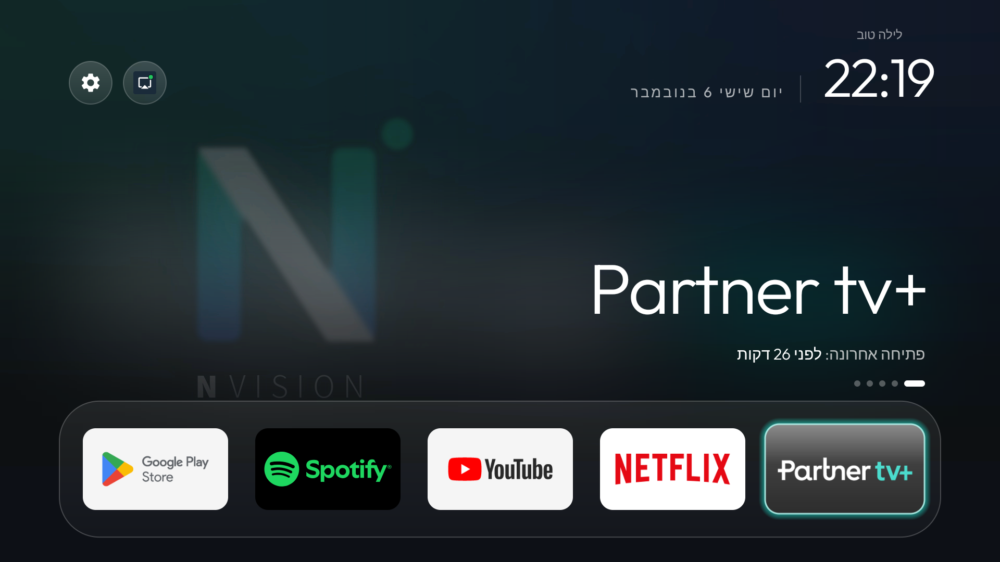

<p align="center"></p>
<h1 align="center">N VISION · Fast TV</h1>

<p align="center">Set up an Android TV / Google TV / Partner TV+ box in minutes: faster, cleaner, an N Vision home
screen with only your apps, and free AirPlay from your iPhone. Your AI assistant does the work; you follow one page.</p>



## How to use it

On a computer on the **same Wi-Fi as the TV**, open [Claude Code](https://claude.com/claude-code) and paste:

```
Set up my Android TV with N Vision Fast TV: clone https://github.com/Nil5959/nvision-fast-tv and follow its PROMPT.md exactly.
```

בעברית:

```
תתקין לי את N Vision Fast TV על הטלוויזיה: תוריד את https://github.com/Nil5959/nvision-fast-tv ותעשה בדיוק מה שכתוב ב-PROMPT-he.md
```

Nothing to install first: the assistant downloads this kit, and the home screen and AirPlay come ready-made from the releases.

A progress page opens in your browser. It shows exactly what to press on the TV remote (turning on Developer options
and USB debugging, pressing Allow), lets you pick your apps, the room name and the app that opens at power-on, and shows
each step with a screenshot from the TV. You never have to type in the chat.

## What it does

1. Backs up the TV's state first and writes a `restore.sh` that undoes everything.
2. Speeds up animations, turns off Google TV recommendations (and voice search if you don't use it).
3. Removes apps you don't use (you tick them on the page; reinstall any time from the Play Store).
4. Installs the [cleanyourtv](https://github.com/Gathin23/cleanyourtv) home screen with the N Vision theme and your apps.
5. Installs [N Vision AirPlay](https://github.com/Nil5959/nvision-airplay): named after the room, starts with the TV,
   shows a 4-digit code over the picture the first time an iPhone connects, goes back to what you were watching when it disconnects, green/red status button.
6. Checks HDMI-CEC (one remote for TV and box), reboots, and verifies it all.
7. Knows what was already done on a TV (run it again any time: it only does what is missing).
8. When you confirm everything works, deletes the backups and leftovers and closes ADB.

Fire TV: a partial run (speed, clean-up and N Vision AirPlay; Fire OS keeps its own home screen). Not for Samsung Tizen, LG webOS or Roku.

## Files

| | |
| --- | --- |
| `PROMPT.md` / `PROMPT-he.md` | the instructions your assistant follows |
| `SKILL.md` | the same as a Claude Code skill: `git clone https://github.com/Nil5959/nvision-fast-tv ~/.claude/skills/nvision-fast-tv` |
| `fasttv.sh` | one command per step: `./fasttv.sh <ip> "<room>" <step>` |
| `progress.py`, `progress.html`, `asks.*.json` | the progress page and its cards |
| `find_tvs.py` | finds the TVs on your network |
| `theme-nvision/` | the N Vision home-screen theme |
| `docs/partner-tv-plus.md` | notes from a real Partner TV+ box |

Undo on a TV: `work/backups/<ip>/restore.sh`.

## Credits and licenses

- Home screen, ADB tools and the safety rules: [cleanyourtv](https://github.com/Gathin23/cleanyourtv) by Gathin, MIT.
- AirPlay: [jqssun/android-airplay-server](https://github.com/jqssun/android-airplay-server), GPL-3.0, based on
  [UxPlay](https://github.com/FDH2/UxPlay); the N Vision fork is [Nil5959/nvision-airplay](https://github.com/Nil5959/nvision-airplay), GPL-3.0.
- This kit: MIT (see `LICENSE`). N Vision name and logo © N Vision.
